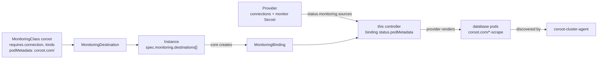

# monitoring-coroot

Send the databases of [OpenEverest](https://github.com/openeverest/openeverest) Instances to
[Coroot](https://coroot.com).

## What this is

A monitoring extension for OpenEverest. It installs the `coroot` `MonitoringClass` and its
controller. The class is **ExtensionManaged**: Coroot's `coroot-cluster-agent` connects to each
database pod itself and finds the pods through `coroot.com/<db>-scrape*` annotations
([MongoDB](https://docs.coroot.com/databases/mongodb/),
[Postgres](https://docs.coroot.com/databases/postgres/)). For every bound Instance the controller
turns the provider's connection endpoints (`Instance.status.monitoring.sources.connections`) into
those annotations and requests them on the binding (`status.podMetadata`); the provider renders
them into the pod templates.



- **Claim.** The class names its controller with `controllerName: openeverest.io/monitoring-coroot`
  (chart value `class.controllerName`); the controller claims every class whose `controllerName`
  is its `--controller-name`. `class.name` is only the name destinations reference.
- **Kinds.** The class requires connections from components whose type has the kind `mongodb` or
  `postgresql` (`requires.kinds`), the databases coroot-cluster-agent connects to.
- **Credentials** are the Instance's read-only `monitor` credential Secret; the controller never
  reads Secrets, coroot-cluster-agent does.
- **TLS** is configured whenever the database accepts it, with the CA the provider publishes, so
  tightening TLS later does not change the annotations.
- **Pods roll** when the annotations are first rendered, changed or removed; the class reports
  `RollingRestart` in `status.providers`.
- The destination has no parameters: coroot-cluster-agent is configured with the Coroot server
  and API key when it is installed.

> [!IMPORTANT]
> **This extension is not standalone.** It requires an OpenEverest installation (core CRDs and
> controller), a provider that publishes connection endpoints, and Coroot with
> `coroot-cluster-agent` in the cluster. It does not install any of them.

## Compatibility

| monitoring-coroot | OpenEverest | Coroot |
|---|---|---|
| `0.1.x` | `2.0.0-dev.5` | `coroot-cluster-agent` with `coroot.com/<db>-scrape` annotation discovery |

The chart and its `MonitoringClass` carry the annotation `openeverest.io/contract-version`, the
contract version of the OpenEverest the controller is built against. It names the oldest
OpenEverest the build works with.

## Requirements

- OpenEverest (see [Compatibility](#compatibility)) and a provider declaring
  `connection: Supported` and `podMetadata: Supported` on a component type of kind `mongodb` or
  `postgresql`. provider-percona-server-mongodb adds this in
  [openeverest/provider-percona-server-mongodb#149](https://github.com/openeverest/provider-percona-server-mongodb/pull/149);
  until a provider ships it, bindings stay `EndpointNotServing`.
- Coroot with `coroot-cluster-agent` (e.g. the `coroot-operator` chart and a `Coroot` CR).
- On OpenShift, the controller runs under the default `restricted-v2` SCC, but Coroot's
  node-agent needs the `privileged` SCC: allow the coroot-operator to grant it (see
  [Coroot on Kubernetes](https://docs.coroot.com/installation/k8s-operator/)).

## Installation

The chart is published as an OCI artifact to GitHub Container Registry:

```bash
helm install monitoring-coroot \
  oci://ghcr.io/openeverest/charts/monitoring-coroot \
  -n everest-system
```

Check that the class is claimed:

```bash
kubectl get monitoringclass coroot
```

Upgrade and uninstall:

```bash
helm upgrade monitoring-coroot \
  oci://ghcr.io/openeverest/charts/monitoring-coroot -n everest-system
helm uninstall monitoring-coroot -n everest-system
```

| Chart value | Default | Purpose |
|---|---|---|
| `class.create` | `true` | Install the `MonitoringClass` |
| `class.name` | `coroot` | Name of the class that destinations reference |
| `class.controllerName` | `openeverest.io/monitoring-coroot` | `controllerName` of the class and the controller's `--controller-name`; the controller claims and serves every class that names it |
| `class.displayName` | `Coroot` | Name shown in the UI |
| `image.repository` | `ghcr.io/openeverest/monitoring-coroot` | Controller image |
| `image.tag` | chart `appVersion` | Controller image tag |
| `leaderElection.enabled` | `true` | Required for `replicaCount` above 1 |
| `logLevel` | `info` | `debug`, `info` or `error` |
| `compatibility.acknowledge.coreVersion` | `""` | OpenEverest release on which to run this build although it does not support it, such as `2.0.0` |

All values are in [values.yaml](charts/monitoring-coroot/values.yaml).

## Usage

```yaml
apiVersion: monitoring.openeverest.io/v1alpha1
kind: MonitoringDestination
metadata:
  name: coroot
spec:
  classRef:
    name: coroot
---
# in the Instance
spec:
  monitoring:
    destinations:
      - name: coroot
        destinationRef:
          name: coroot
```

```bash
kubectl get mbind -l core.openeverest.io/instance=<instance>   # Configured lists the components
kubectl get pods -l core.openeverest.io/instance=<instance> -o jsonpath='{.items[*].metadata.annotations}'
```

| Configured reason | Meaning |
|---|---|
| `Configured` | Annotations requested; the provider renders them on the pods |
| `Pending` | The binding is not accepted yet; any earlier request is held |
| `NotAccepted` | Core rejected the binding; the request is withdrawn |
| `EndpointNotServing` | The Instance publishes no connection endpoints yet; any earlier request is held |
| `RenderFailed` | No endpoint Coroot can connect to (unsupported kind, port name instead of number, CA and client certificate in different Secrets) |

## Development

| Command | Purpose |
|---|---|
| `make test-unit` | Unit tests |
| `make lint` | golangci-lint |
| `make run` | Run the controller against the current kubeconfig |
| `make helm-lint` | Lint the chart |
| `make generate` | Stamp the chart with the OpenEverest contract version of the core in `go.mod` |
| `make verify` | Fail when `make generate` changes anything or the `MonitoringClass` does not carry the stamp |

### Integration tests

The chainsaw suite under [test/integration/](test/integration/) runs in a k3d cluster that holds
only the OpenEverest CRDs of the core version [go.mod](go.mod) pins. No OpenEverest controller,
provider or Coroot runs; the test publishes an Instance's connection endpoints and creates and
accepts the Instance-owned binding itself, then asserts the requested `status.podMetadata`, the
binding and destination conditions, and that the request is held while the Instance publishes
no connections. The controller runs in a namespace that enforces the restricted Pod Security
Standard.

```bash
make k3d-cluster-up
make docker-build load-image IMG=monitoring-coroot:dev
make install-crds
make deploy-ci IMG=monitoring-coroot:dev
make test-integration
make k3d-cluster-down
```

CI ([.github/workflows/ci.yaml](.github/workflows/ci.yaml)) runs lint, build, unit tests,
module tidiness, copyright headers, Helm lint and the integration suite on every pull request.

### Releasing

Pushing a `vX.Y.Z` (or `vX.Y.Z-<suffix>`) tag builds the multi-arch image
`ghcr.io/openeverest/monitoring-coroot:X.Y.Z`, then publishes the chart with that version to
`oci://ghcr.io/openeverest/charts` and creates the GitHub release. The release fails unless the
[Compatibility](#compatibility) table has a row for the tag's minor series. Every push to `main`
publishes `ghcr.io/openeverest/monitoring-coroot-dev`.

## Contributing

Issues and pull requests are welcome. Commits must be signed off (`git commit -s`). See the
[OpenEverest Code of Conduct](https://github.com/openeverest/openeverest/blob/main/CODE_OF_CONDUCT.md).

## Security

Report vulnerabilities per the
[OpenEverest security policy](https://github.com/openeverest/openeverest/blob/main/SECURITY.md).
Please do not open public issues for security reports.

## License

[Apache 2.0](LICENSE)
