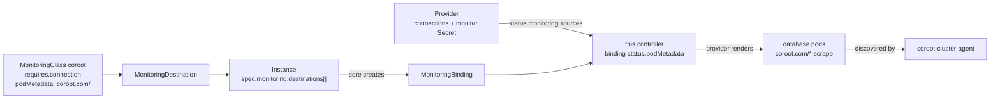

# monitoring-coroot

> [!WARNING]
> **Draft.** Depends on the unmerged monitoring connection sources API
> (openeverest/openeverest#3501); `go.mod` replaces core with a local checkout.

Send the databases of [OpenEverest](https://github.com/openeverest/openeverest) Instances to
[Coroot](https://coroot.com).

## What this is

A monitoring extension for OpenEverest. It installs the `coroot` `MonitoringClass` and its
controller. The class is **ExtensionManaged**: Coroot's `coroot-cluster-agent` connects to each
database pod itself and finds the pods through `coroot.com/<db>-scrape*` annotations
([MongoDB](https://docs.coroot.com/databases/mongodb/),
[Postgres](https://docs.coroot.com/databases/postgres/)). For every bound Instance the controller
turns the provider's connection endpoints (`Instance.status.monitoring.sources.connections`) into
those annotations and requests them on the binding (`status.podMetadata`); the provider renders
them into the pod templates.



- **Credentials** are the Instance's read-only `monitor` credential Secret; the controller never
  reads Secrets, coroot-cluster-agent does.
- **TLS** is configured whenever the database accepts it, with the CA the provider publishes, so
  tightening TLS later does not change the annotations.
- **Pods roll** when the annotations are first rendered, changed or removed; the class reports
  `RollingRestart` in `status.providers`.
- The destination has no parameters: coroot-cluster-agent is configured with the Coroot server
  and API key when it is installed.

## Requirements

- OpenEverest with the connection sources API and a provider declaring
  `connection: Supported` (e.g. provider-percona-server-mongodb).
- Coroot with `coroot-cluster-agent` (e.g. the `coroot-operator` chart and a `Coroot` CR).

## Usage

```bash
helm install monitoring-coroot charts/monitoring-coroot -n openeverest-system
```

```yaml
apiVersion: monitoring.openeverest.io/v1alpha1
kind: MonitoringDestination
metadata:
  name: coroot
spec:
  classRef:
    name: coroot
---
# in the Instance
spec:
  monitoring:
    destinations:
      - name: coroot
        destinationRef:
          name: coroot
```

```bash
kubectl get mbind -l core.openeverest.io/instance=<instance>   # Configured lists the components
kubectl get pods -l core.openeverest.io/instance=<instance> -o jsonpath='{.items[*].metadata.annotations}'
```

| Configured reason | Meaning |
|---|---|
| `Configured` | Annotations requested; the provider renders them on the pods |
| `Pending` | The binding is not accepted yet; any earlier request is held |
| `NotAccepted` | Core rejected the binding; the request is withdrawn |
| `EndpointNotServing` | The Instance publishes no connection endpoints yet; any earlier request is held |
| `RenderFailed` | No endpoint Coroot can connect to (unsupported kind, port name instead of number, CA and client certificate in different Secrets) |

## Development

| Command | Purpose |
|---|---|
| `make test-unit` | Unit tests |
| `make lint` | golangci-lint |
| `make run` | Run the controller against the current kubeconfig |
| `make helm-lint` | Lint the chart |

## License

[Apache 2.0](LICENSE)
